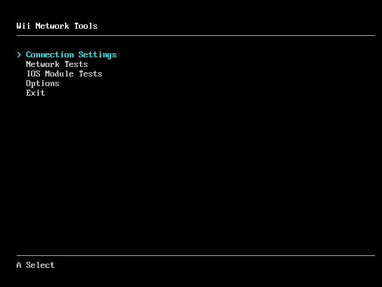

# Wii Network Tools

Wii homebrew for editing and testing network connection profiles.



## Features

- *Connection Settings* - connection editing for systems where the System Menu isn't available
- *Network Tests* - DNS, TCP, UDP, and throughput (iperf3) tests
- *IOS Module Tests* - various test suites that check conformance with the stock SO and WD IOS modules

## Installing

Download the [latest release](https://github.com/loopj/wii-network-tools/releases/latest) and unzip it, then copy the `apps` folder to the root of your USB drive or SD card.

To test the network the way a game uses it, build the disc image and launch it from a USB loader instead. It then runs on the IOS the loader provides, and it keeps the iperf3 server in its own save.

## USB Gecko

With a USB Gecko in memory card slot B, every test result is also logged to USB Gecko.

## Building

Install devkitPPC and libogc from devkitPro, and optionally `wit` from Wiimms ISO Tools to build a disc image.

```bash
cmake -B build
cmake --build build
```

Homebrew is built to `build/homebrew/apps/wii-network-tools`, disc image is built to `build/NETE01.wbfs`.
